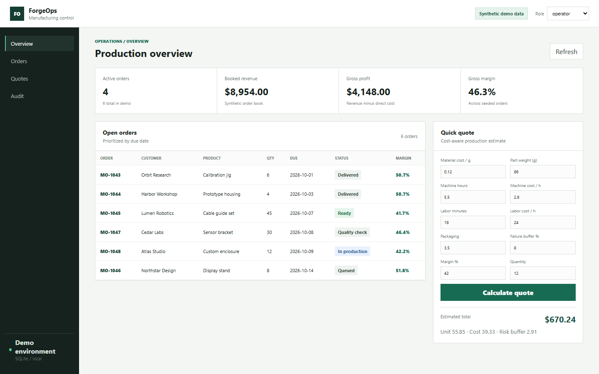

# Small Manufacturing Operations Demo

[English / README principal](README.md) · Português (Brasil)

Um painel de operações adequado para apresentação em portfólio, inspirado em fluxos reais de pequenas operações de fabricação e impressão 3D. Todos os clientes, pedidos e valores financeiros são fictícios.



## O que o projeto demonstra

- API em FastAPI e persistência em SQLite.
- Fluxo de pedidos e acompanhamento do status de produção.
- Motor de orçamento baseado em custos, utilizando cálculos com `Decimal`.
- Controle de acesso por papéis (RBAC) demonstrativo, com os papéis de visualizador, operador e administrador.
- Eventos de auditoria imutáveis para alterações de status.
- Painel responsivo voltado ao trabalho, sem framework de frontend.
- Testes, GitHub Actions e empacotamento com Docker.

## Executar

```bash
python -m venv .venv
.venv\Scripts\activate
python -m pip install -r requirements.txt
python -m uvicorn app.main:app --reload
```

Abra `http://127.0.0.1:8000`. A documentação da API está disponível em `/docs`.

## Testes

```bash
pytest -q
```

## Limites de segurança

Este repositório tem um novo histórico público e não contém bancos de dados de produção, registros de clientes, notas fiscais, recibos, credenciais, preços comerciais ou arquivos privados de marcas. Os papéis definidos por cabeçalhos estão deliberadamente limitados à demonstração local e não são apresentados como autenticação para produção.

## Licença

MIT
